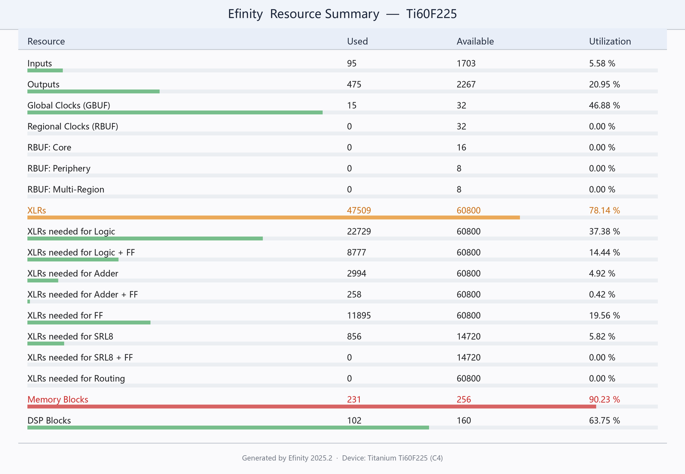
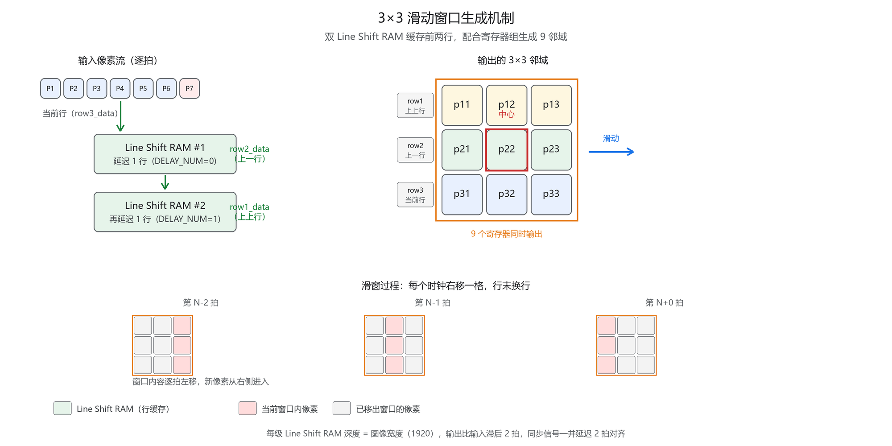

# Ti60F225 实时图像边缘检测与目标识别

> 基于 **Efinix Titanium Ti60F225** FPGA 的全流水线实时图像处理系统
> MIPI CSI-2 摄像头采集 → 边缘检测 / 目标识别 → HDMI 1080p60 输出

<p align="center">
  
</p>

---

## 项目简介

本项目在厂商 Ti60_Demo 工程基础上，注入自研图像算法链，实现 **1920×1080@60Hz** 全分辨率、逐像素流式的实时边缘检测与目标识别，无需帧缓冲、无反馈环路。

| 项目 | 指标 |
|---|---|
| 器件 | Titanium **Ti60F225**（C4，t16ff） |
| 工具链 | Efinity **2025.2.288.4.15** |
| 采集 | VS-SC2210 彩色传感器，MIPI CSI-2 **4-lane** |
| 处理分辨率 | **1920 × 1080**（全分辨率，非降采样） |
| 输出 | HDMI 1.4，**1080p60** |
| 编译状态 | map / interface / pnr / pgm **四阶段全 PASS** |
| 时序 | **0 条 setup 违规、0 条 hold 违规** |

> 赛题基础要求为 640×480@60Hz，本设计达到 **6.75 倍**像素量（2 073 600 / 307 200）。

---

## 算法流水线

```
MIPI CSI-2 ──► demosaic ──► AWB 白平衡 ──► 灰度化 ──► 3×3 取窗
                                                          │
                          ┌───────────────────────────────┴──────────┐
                          ▼                                          ▼
                    中值滤波 (3×3)                            Sobel 梯度
                          │                                          │
                          └──────────────► 显示选择 ◄────────────────┘
                                              │
                                        OSD / 目标框
                                              │
                                          HDMI TMDS
```

全链路位于单一 `clk_pixel_2x`（148.81 MHz）时钟域内，**自研部分不引入跨时钟域风险**。

### 3×3 滑动窗口机制

<p align="center">
  
</p>

双 Line Shift RAM 缓存前行，配合寄存器组生成 9 邻域，每个时钟右移一格、行末换行。

### 关键设计取舍

| 计算 | 常规做法 | 本项目做法 |
|---|---|---|
| 灰度加权 `Y=(77R+150G+29B)>>8` | 3 个乘法器 | **移位加法**，纯组合 |
| Sobel 系数 ×2 | 乘法器 | `{data, 1'b0}` 左移 |
| 梯度幅值 | 平方根 / DSP | `\|Gx\|+\|Gy\|` |
| 白平衡增益 | 乘法器 → 推断 DSP | **显式移位加法树** |
| 3×3 中值 | 串行排序器 | **Smith 中值网络**（31 个比较器并行） |

> 早期版本（v5/v6）凭借上述设计做到 **DSP = 0**。V13.x 引入目标识别后 DSP 增至 102 个。

---

## 目录结构

```
.
├── rtl/                  # 自研 RTL 源码
│   ├── edge_detect_top.v         # 顶层
│   ├── rgb2gray.v                # 灰度化（移位加法）
│   ├── line_buffer_3x3.v         # 3×3 行缓存取窗
│   ├── median_filter_3x3.v       # 中值滤波
│   ├── sobel_3x3.v               # Sobel 梯度
│   ├── threshold_ctrl.v          # 阈值控制
│   ├── display_mux.v             # 显示选择与对齐
│   ├── dvp_capture.v             # DVP 采集
│   ├── i2c_master.v / cam_init_ctl.v   # 摄像头寄存器配置
│   ├── debounce.v                # 按键消抖
│   └── video_timing_640x480.v    # 视频时序
├── awb/                  # 自动白平衡（AWB）
│   ├── wb_awb.v / wb_apply.v
│   └── tb_wb_awb.v + 实测日志
├── sim/                  # 仿真 testbench 与日志
├── verify/               # 独立复核（中值网络对比等）
├── efinity/              # Efinity 构建脚本
│   └── build_efinity.ps1
└── docs/images/          # 文档配图
```

---

## 文档

仓库保留三篇核心文档：

| 文档 | 内容 |
|---|---|
| [01 技术方案与实施计划](01-技术方案与实施计划.md) | 整体架构与实施路径 |
| [19 资源与时序报告](19-资源与时序报告.md) | LUT / DSP / BRAM 占用、Fmax 余量、时序结论 |
| [28 按键操作手册（V13.3）](28-按键操作手册.md) | 当前上板版本的操作说明 |

---

## 编译方法

### 前置要求

- Efinity **2025.2**（默认安装于 `C:\Efinity\2025.2`）
- PowerShell 5.1+

### 一键构建

```powershell
cd efinity
.\build_efinity.ps1              # 只跑综合（map）
.\build_efinity.ps1 -Flow pnr     # 综合 + 布局布线
.\build_efinity.ps1 -Flow compile # 完整流程，生成码流
```

> ⚠️ **Efinity 的 C++ 工具无法读取非 ASCII 路径**（会报 `Illegal byte sequence`）。
> `build_efinity.ps1` 会自动把源码同步到纯英文路径 `D:\fpga_edge_detect\EdgeDetect` 再构建，
> 源码的权威副本仍在 `rtl/`。

### 手动构建

```powershell
cd "D:\fpga_edge_detect\VF2026_HDMI_V5"
& "C:\Efinity\2025.2\bin\efx_run.bat" "Ti60_Demo.xml" --prj -f compile
```

产物位于 `outflow\`，码流为 `Ti60_Demo.bit`。

### 如何查看资源报告

编译完成后，资源数据分布在 `outflow\` 的四个文件中：

| 数据 | 文件 | 查找方式 |
|---|---|---|
| LUT/FF/ADD/SRL/RAM/DSP 总数 | `Ti60_Demo.info.log` | 搜 `Resource Summary` |
| 逐模块资源分解 | `Ti60_Demo.res.csv` | 制表符分隔，跳过前 4 行注释 |
| 层级化统计 | `Ti60_Demo-hierarchical_stats.rpt` | 固定宽度表格 |
| IO / 时钟 / XLR 总量 | `Ti60_Demo.place.rpt` | 搜 `Resource Summary` |

时序数据在 `Ti60_Demo.timing.rpt`，四个章节：

| 章节 | 内容 |
|---|---|
| `1. Clock Frequency Summary` | 约束频率 + **Fmax（Maximum possible analyzed clocks frequency）** |
| `2. Clock Relationship Summary` | 各时钟对 slack |
| `3. Path Details for Max Critical Paths` | setup 最差路径 |
| `4. Path Details for Min Critical Paths` | hold 最差路径 |

> 💡 **判断时序是否违规不要用 `grep VIOLATED`** —— 该报告可能一处都不出现，容易误判为"没问题"。
> 可靠做法是找**负号 slack**。

---

## 验证方法

```powershell
# 1) 四阶段是否都通过
Select-String outflow\Ti60_Demo.log -Pattern "PASS|FAIL" | Select-Object -Last 10

# 2) 负 slack 条数（应为 0）
(Select-String outflow\Ti60_Demo.timing.rpt -Pattern "^\s+\S+\s+\S+\s+\S+\s+-").Count

# 3) DSP 占用
Select-String outflow\Ti60_Demo.res.csv -Pattern "^\s*\+example_top"
```

仿真：

```powershell
cd sim
.\run_sim.ps1
```

---

## 资源占用（V13.3 当前版）

| 资源 | 已用 | 总量 | 占比 |
|---|---|---|---|
| XLR（逻辑单元） | 47 509 | 60 800 | **78.14 %** |
| Memory Blocks | 231 | 256 | **90.23 %** |
| DSP Blocks | 102 | 160 | 63.75 % |
| Global Clocks | 15 | 32 | 46.88 % |

> ⚠️ **版本说明**：上表为 **V13.3**（含目标识别、多帧对比等扩展功能）的数据。
> 早期 v5/v6 版本资源占用低得多（LUT 5 355 / FF 4 241 / RAM 55 / **DSP 0**），
> 详见 [19 号资源与时序报告](19-资源与时序报告.md)。两者不是同一版本，**请勿混用**。

---

## 许可与致谢

- 厂商 IP（DDR3 控制器、MIPI CSI-2、HDMI TMDS、demosaic 等）版权归 **Efinix** 及原厂所有
- 本仓库中的 `rtl/`、`awb/`、`sim/`、`verify/` 及全部文档为自研成果
- 器件与工具链：Efinix Titanium Ti60F225 / Efinity 2025.2

---

<p align="center">
  <sub>Efinix Titanium Ti60F225 · Efinity 2025.2 · 1920×1080@60Hz 实时处理</sub>
</p>
